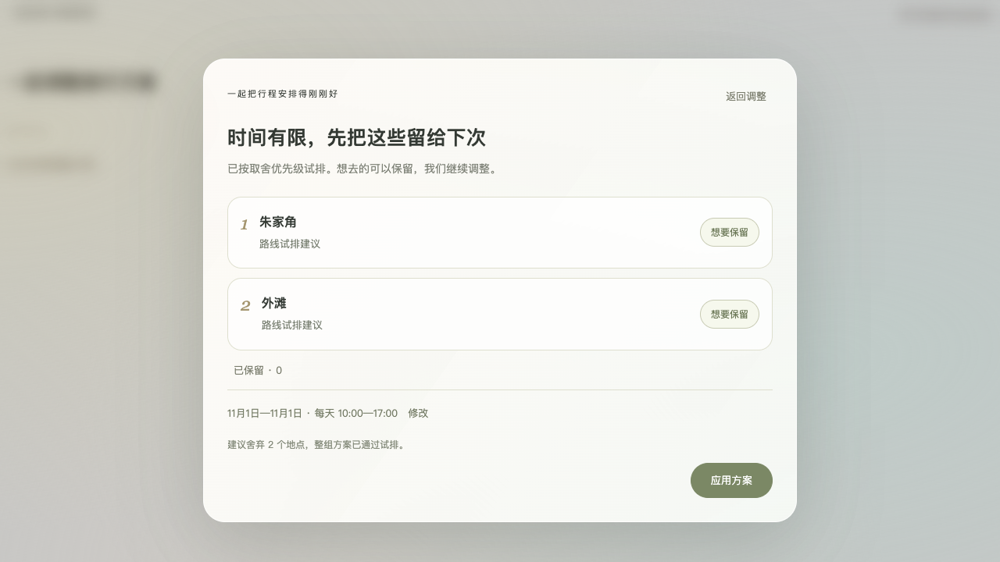

# 取舍与追加协商

2026-10-17，按本轮确认实现。根目录演示页与 upstream-latest 正式 Vue 工程同步使用新的规划模块。

## 行为

- 超时时，沿既有舍弃排序逐步试排，展示首个可行前缀；并非声称找到全局最少删除组合。
- 点击「想要保留」：条目左滑，原位三点跳动，短暂提示保留成功，然后其余条目上移并补入新的可行建议，允许补多个。
- 保留是本轮硬约束，可从「已保留」入口撤销；协商阶段不再受初次问答的 20% 配额限制。
- 没有可行方案时禁用生成，提供延长时间与调整保留地点入口；不再提供部分行程绕过入口。
- 日期范围与每日开始、结束时间可在独立窗口修改，点击「保存并核算」后统一核算。原有全部选点能排入时，舍弃列表退出，显示全部可安排。
- 首次可行行程可以推荐未选择的同线路新地点。优先采用已有顺路推荐排序，补充按兴趣排序的点位，每轮至多检查 8 个候选。
- 追加方案逐个联合试排，校验开放时间、游玩时长、交通及已有需求；新增点所在日结束至少保留 15 分钟余量。90 分钟空余不是强制追加门槛：不足 90 分钟但完整点位能放入时，也会推荐。
- 「不想追加」排除该候选并补位；用户可以「不追加，直接生成」。如果时间修改后连原选点也无法安排，则此按钮同样禁用。
- 应用舍弃方案后直接生成，不再次自动弹出追加协商。
- 请求以序号和 AbortController 防止过期结果覆盖新条件；失败时不能应用旧方案。

## 数据与范围

试排使用现有规划服务，交通和开放信息沿用现有数据来源与确定性标记。理由使用现有偏好匹配、路线试排说明，不编造「节省时间」。单点增加时长仅在推荐接口返回计算结果时展示，并明确与联合方案区分。

协商面板修改的日期与时间用于本次生成，按整趟行程统一设置每日时间。未新增逐日不同时间编辑或外部 POI 搜索。

## 验证

- 内容工作区完整单元/接口测试：110/110 通过。
- 正式 Vue 工程完整单元/接口测试：154/154 通过。
- 新协商浏览器测试：4/4 通过。覆盖自动前缀、保留动画与补位、硬约束提交、时间扩展后全部保留、追加换点及跳过、保留耗尽阻止生成、390px 布局。
- 正式工程 Vite 构建通过，git diff --check 通过。
- 浏览器测试使用合成点位和接口响应；没有调用付费模型或外部交通服务。接口测试另覆盖真实本地服务。

浏览器回归在可访问项目源码的本机服务下运行：

```sh
NEGOTIATION_TEST_ORIGIN=http://127.0.0.1:5180 node --test tests/planning-negotiation-browser.mjs
```




## 限流与错误恢复修复（2026-10-17）

用户实际预览发现：后台仍运行 13:46 启动的旧版本，逐组合的多次 HTTP 请求触发旧限流；客户端错误分支又清空建议，导致大片空白和禁用的应用按钮。

- 将多组合试排放到同一个后台规则任务，一轮协商仅需创建会话、提交批量任务两个 POST；候选事实一次读取，查询任务进度仍为 GET。
- 失败保留旧建议供参考及用户保留/时间设置，旧建议不能应用。错误卡片说明失败和下一步，底部只保留一个明确的重试主按钮。
- 429 返回重试秒数，客户端显示倒计时，期间不自动重复请求；修改时间也不会绕过冷却或卡在加载状态。
- 最近相同条件的已成功核算结果在面板内复用；新增独立的「修改时间」按钮。
- 已重启实际 5180 集成预览，接口确认 negotiation=batch.v1。真实 8 点位试排只发出 2 个 POST，返回可行的 7 点舍弃方案。
- 正式工程完整测试 156/156、协商浏览器测试 5/5、Vite 构建通过。

## 保存时间后核算与任务调度（2026-10-17）

时间入口改为独立窗口：编辑四个字段不发请求；取消或原样保存不发请求；有效改动点击「保存并核算」后，统一提交一次。开始/结束顺序与 1–14 天范围在提交前校验。

初次生成和协商任务进入后台队列：全局最多同时执行 2 个，同一用户最多 1 个；同一面板的新条件取消旧任务，其他面板按队列等待。任务状态在页面显示等待/核算。客户端停止等待或替换计算时会请求取消后台任务，独立取消接口检查用户归属和来源。

相同任务在执行期间复用；成功的只读试排结果按用户和条件缓存 2 分钟，面板内缓存同样限时。正常生成不会复用过期的已生成行程作为缓存结果。队列设有容量上限，避免无界占用。

规则规划、试排、大模型、其他写操作分别限流。模型传输也使用有限并发队列，超过当前并发时等待；遇到服务商临时错误会延迟重试，429 尊重 Retry-After，等待可以取消。

正式工程测试 164/164 通过；协商浏览器测试 5/5 通过，已覆盖“编辑不请求、取消不请求、原样保存不请求、保存有效变动核算一次”。构建通过。已重启 5180，实际接口 negotiation=batch.v2，真实试排初始状态 queued、重复提交命中缓存。
