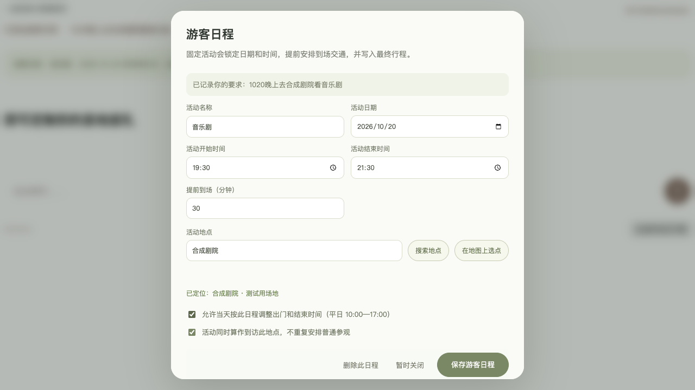
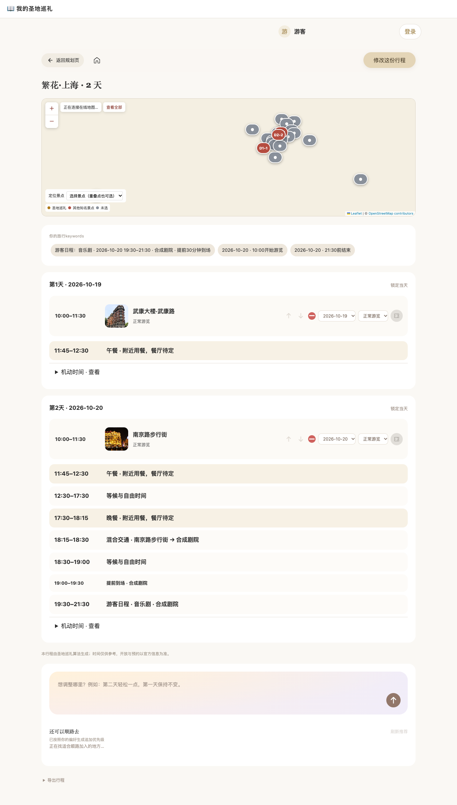

# 游客日程

2026-10-17，按本轮确认新增。

## 使用

定制问答新增特殊日程问题，也可在其他自由输入中写「1020 晚上去上海大剧院看音乐剧」。点击生成会先保留并识别此要求；缺少日期、场地地图位置、起止时间时打开游客日程补充窗口。原文保留可见，尚未补全时不能绕过生成。支持最多 10 项同日内活动，可以修改或删除。

场地可用已有点位、地图搜索结果或用户地图选点。上海大剧院已通过现有 Photon 搜索实际找到，地点信息与演出场次分开：不会把地图地址当作已核验的音乐剧时间。

提前到场默认 30 分钟，明确显示且可改。超出平日游览时间时，用户勾选允许调整活动当天的出门/结束时间，其他日期保持原时间。活动与提前到场重叠会直接要求调整，不通过删除普通景点掩盖。跨午夜活动目前需按日期拆分，不猜散场时间。

## 规划与显示

- 游客日程作为硬约束进入固定活动排程；交通、提前到场、活动本身分别在时间轴展示。
- 活动场地不在景点库时建立本次日程位置，随行程保存并显示在地图。常规参观开放时间不误挡用户填写的演出时段。
- 用户可选择活动是否同时算作到访此地，避免重复安排普通参观。
- 允许只规划游客日程，不要求为了生成另外选择无关景点。确认舍弃所有普通景点时，固定日程仍保留。
- 有活动的行程会额外尝试围绕场地的跨日分组，即便初始方案已经可行，也比较交通与负荷；仍是有预算的启发式搜索，不声称全局最优。
- Keywords 明确显示活动名称、日期、起止、场地与提前到场。正式页面、文字导出、修改预览均包含活动。
- 修改、应用与撤销保留场地与硬约束；大模型优化候选若改变活动日期、时间或场地，初次生成流程保留原规则方案。

## 验证

- 正式工程完整测试：177/177 通过。
- 游客日程专项测试涵盖识别/缺失追问、硬约束、外部场地、提前到场、精确时刻、跨天分组、重复参观避免、只有活动的行程、活动冲突、修改提交撤销、截止偏好误识别。
- 真实本机规则接口与浏览器端到端：2/2 通过。验证未提交的自由文字点生成也能进入 SOP；补齐后在 Keywords、时间轴和正式 Vue 行程页显示；未补齐仍保留、删除有效。
- 既有取舍协商浏览器回归：5/5 通过。
- Vite 构建、diff 格式检查通过。
- 截图使用合成剧院和合成演出时间，只验证功能，不代表真实场次；未调用付费模型。

预览入口：http://127.0.0.1:5180/customize/fanhua-shanghai

